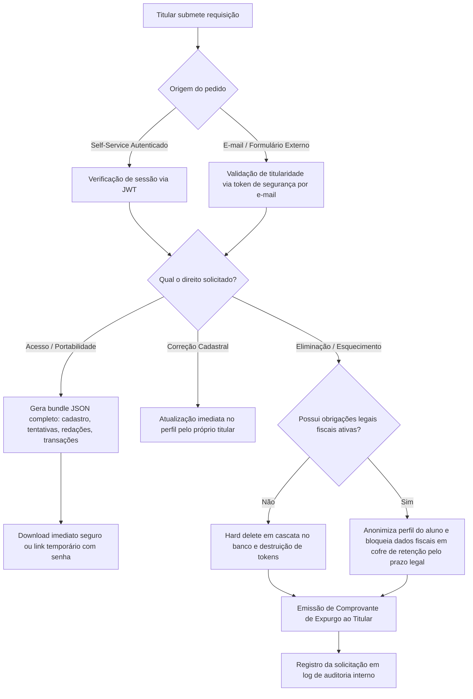

# Fluxo de Atendimento aos Direitos do Titular (DSAR) — Concurso AI (Engrama)

**Versão**: 1.0  
**Data**: 07/11/2026  
**Auditor**: LGPD Audit Maestro  
**Norma de Referência**: Arts. 18 e 19 da Lei Federal nº 13.709/2018 e Resolução CD/ANPD nº 2/2022 (ATPP)  

---

## 1. Prazos Legais Obrigatórios de Atendimento (SLA)

| Modalidade de Resposta | Artigo Legal | Prazo Geral (LGPD) | Prazo para ATPP (Res. 2/2022, Art. 14) |
|---|---|---|---|
| **Confirmação e Acesso Simplificado** | Art. 19, I | Imediato (formato eletrônico instantâneo) | Imediato |
| **Declaração Clara e Completa (Exportação Integral)** | Art. 19, II | **15 dias corridos** | **30 dias corridos** |
| **Correção de Dados Incompletos ou Inexatos** | Art. 18, III | Imediato via interface self-service | Imediato |
| **Eliminação de Dados / Exclusão de Conta** | Art. 18, VI | **15 dias corridos** | **30 dias corridos** |
| **Informação sobre Compartilhamentos** | Art. 18, VII | Disponível permanentemente na Política de Privacidade | Permanente |

---

## 2. Canais de Entrada de Requisições (Intake)

1. **Canal Self-Service In-App (Titular Autenticado)**:
   - Configurações da Conta (`/settings` ou `/profile`) no painel do aluno.
   - Botão direto: *"Baixar Meus Dados (Portabilidade JSON)"*.
   - Botão direto: *"Excluir Minha Conta em Definitivo"*.
2. **Canal Direto do Encarregado (E-mail)**:
   - E-mail institucional de contato: `privacidade@engrama.tech` ou formulário na página de ajuda.

---

## 3. Fluxograma Operacional de Atendimento (Workflow)

