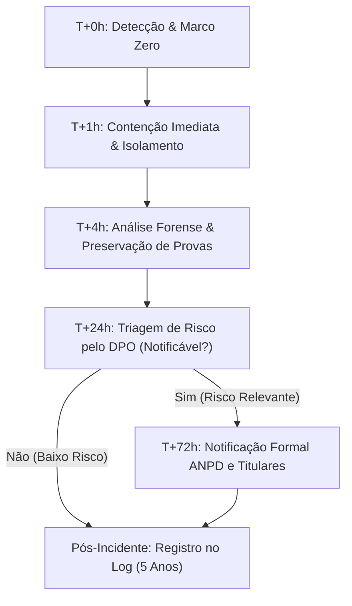

# Plano de Resposta a Incidentes de Segurança com Dados Pessoais (PRISDP)

> [!IMPORTANT]
> **RASCUNHO — PENDENTE DE REVISÃO JURÍDICA**
> Este documento constitui minuta técnica e operacional preliminar para conformidade com a Lei Geral de Proteção de Dados (Lei Federal nº 13.709/2018 - LGPD) e a Resolução CD/ANPD nº 15/2024 (Regulamento de Comunicação de Incidentes de Segurança - RCIS). Deve ser submetido à validação de assessoria jurídica especializada antes de sua adoção formal definitiva.

---

## 1. Objetivo e Escopo

Este Plano estabelece a metodologia operacional, a matriz de severidade, os fluxos de contenção técnica e os procedimentos de comunicação formal para o tratamento de qualquer **incidente de segurança da informação** que resulte em acessos não autorizados, situações acidentais ou ilícitas de destruição, perda, alteração, comunicação ou difusão de dados pessoais sob controle ou custódia do **Engrama** (Engrama Tecnologia Educacional Ltda.).

Aplica-se a:
1. Toda a infraestrutura em nuvem, bancos de dados (MySQL, Redis) e serviços back-end/front-end da plataforma.
2. Todos os operadores e subprocessadores contratados (Stripe, Google Cloud, OpenAI, Anthropic, Resend, Vercel/VPS).
3. Todos os colaboradores, administradores e desenvolvedores com acesso a credenciais e ambientes de dados.

---

## 2. Comitê de Resposta a Incidentes de Segurança (CSIRT)

Em caso de suspeita ou confirmação de incidente, o comitê multidisciplinar é ativado imediatamente:

| Função no Comitê | Responsável / Ponto Focal | Atribuição Principal |
| :--- | :--- | :--- |
| **Encarregado (DPO)** | `dpo@engrama.com.br` | Liderança regulatória, avaliação de risco, contato oficial com ANPD e titulares. |
| **Lead de Engenharia / Segurança** | Squad de Infraestrutura & Backend | Contenção técnica imediata, coleta forense de logs, isolamento e remediação. |
| **Lead de Produto / Operações** | Coordenação da Plataforma | Impacto aos usuários, planos de contingência e comunicação operacional. |
| **Assessoria Jurídica** | Assessoria Especializada LGPD | Revisão legal das notificações formais e suporte probatório. |

---

## 3. Matriz de Classificação de Severidade

A classificação do incidente determina a prioridade de contenção e o dever de notificação externa (Art. 5º da Res. CD/ANPD nº 15/2024):

```
+-----------------------------------------------------------------------------+
| GRAVIDADE | CRITÉRIO DE AFETAÇÃO                      | SLA NOTIFICAÇÃO    |
|-----------+-------------------------------------------+---------------------|
| CRÍTICA   | Exfiltração de senhas/hashes, tokens      | ANPD: 3 dias úteis  |
|           | ativos, pagamentos, CPFs ou dados sensíveis| Titulares: Imediato |
|           | de larga escala / menores de idade.       | (até 3 dias úteis)  |
|-----------+-------------------------------------------+---------------------|
| ALTA      | Acesso indevido a dados cadastrais com    | ANPD: 3 dias úteis  |
|           | credenciais ou dados de autenticação de   | Titulares: Avaliado |
|           | grupo específico de titulares.            | com o DPO           |
|-----------+-------------------------------------------+---------------------|
| MÉDIA     | Exposição de dados cadastrais gerais      | Registro interno em |
|           | (ex: nome e telefone sem senhas) com      | log (sem dano       |
|           | baixo risco aos direitos fundamentais.    | relevante imediato) |
|-----------+-------------------------------------------+---------------------|
| BAIXA     | Incidente contido sem exposição de PII,   | Registro no log     |
|           | indisponibilidade temporária de serviço ou| interno (guarda de  |
|           | incidente em ambiente de teste/sandbox.   | 5 anos)             |
+-----------------------------------------------------------------------------+
```

### 3.1 Critério Cumulativo de Notificação Obrigatória (Res. 15/2024, Art. 5º)
O incidente será notificado à ANPD e aos titulares se e somente se:
1. **Puder acarretar risco ou dano relevante** aos direitos e liberdades dos titulares; **E**
2. **Envolver pelo menos uma das hipóteses**:
   - Dados de autenticação (hashes de senhas, tokens de sessão, refresh tokens);
   - Dados financeiros (cartões, transações);
   - Dados sensíveis ou de menores de idade / ECA Digital;
   - Violação de dados em larga escala.

---

## 4. Fluxo e Linha do Tempo de Resposta (Timeline Operacional)



### Fase 1: Detecção e Contenção Imediata (T+0h a T+4h)
1. **Marcação do Timestamp (Marco Zero)**: Registra no relatório o dia e a hora em que a equipe tomou ciência do fato.
2. **Isolamento de Sistemas**:
   - Se chave de API ou segredo foi exposto (ex: `ENCRYPTION_KEY`, `JWT_SECRET`, `OPENAI_API_KEY`, `STRIPE_SECRET_KEY`), revogar e rotacionar as credenciais imediatamente.
   - Se sessão ou token foi comprometido, forçar invalidação em massa via incremento de `tokenVersion` no banco de dados.
   - Se o host foi invadido, isolar a instância de rede sem desligar bruscamente para preservar memória e logs forenses.
3. **Preservação de Evidências**:
   - Extrair e armazenar com hash de integridade os logs do MySQL, NGINX, Redis e Express.
   - NUNCA executar `DROP TABLE`, limpar histórico ou sobrescrever logs durante a investigação.

### Fase 2: Diagnóstico e Avaliação de Risco (T+4h a T+24h)
1. Identificar:
   - Volume exato de titulares afetados (consultar banco de dados via query de auditoria).
   - Quais categorias de dados foram expostas (nomes, e-mails, telefones, hashes).
   - Se houve acesso a dados de menores de 18 anos ou dados sensíveis.
2. O DPO aplica o teste do Art. 5º da Resolução CD/ANPD nº 15/2024 para definir formalmente a obrigatoriedade de comunicação.

### Fase 3: Comunicações Regulatórias (T+24h a T+72h — Máximo 3 dias úteis)
1. **Comunicação à ANPD**:
   - O DPO protocola comunicado eletrônico perante a ANPD no prazo regulamentar improrrogável de **3 dias úteis**, nos termos do Art. 6º da Res. 15/2024.
2. **Comunicação aos Titulares Afetados**:
   - Disparo por e-mail direto a todos os titulares afetados em linguagem clara e acessível, com recomendações de segurança (troca de senhas, ativação de MFA).
3. **Divulgação Ampla (se aplicável)**:
   - Caso não seja possível identificar ou contatar individualmente todos os titulares, publicar aviso de segurança em destaque no portal eletrônico do Engrama.

### Fase 4: Registro Obrigatório e Lições Aprendidas (Pós-Incidente)
1. **Registro no Arquivo de Guarda (5 Anos)**:
   - Registrar todos os dados do incidente em `.lgpd/incidents/log.md`, conforme exigido pelo Artigo 10 da Res. 15/2024.
2. **Relatório Post-Mortem**:
   - Elaborar relatório técnico de causa-raiz e plano de ação preventivo (melhorias em código, testes automatizados, revisão de IAM).

---

## 5. Templates de Comunicação Prontos para Uso

### Template A: Comunicação Oficial à ANPD (Res. 15/2024, Art. 6º, § 2º)

```markdown
# COMUNICAÇÃO DE INCIDENTE DE SEGURANÇA COM DADOS PESSOAIS À ANPD
(Nos termos do Art. 48 da Lei nº 13.709/2018 e Art. 6º da Resolução CD/ANPD nº 15/2024)

1. IDENTIFICAÇÃO DO CONTROLADOR
- Razão Social: Engrama Tecnologia Educacional Ltda.
- CNPJ: [CNPJ DA EMPRESA]
- Endereço da Sede: [ENDEREÇO COMPLETO]

2. DADOS DE CONTATO DO ENCARREGADO (DPO)
- Nome: Comitê de Governança e Privacidade de Dados
- E-mail: dpo@engrama.com.br
- Telefone de Contato: [TELEFONE]

3. DATA E HORA DO INCIDENTE
- Data e Hora da Ocorrência Estimada: AAAA-MM-DD HH:MM (UTC-3)
- Data e Hora do Conhecimento pelo Controlador: AAAA-MM-DD HH:MM (UTC-3)

4. NATUREZA E DESCRIÇÃO DO INCIDENTE
[Descrição detalhada da forma de violação: ex.: acesso indevido, vulnerabilidade explorada, exfiltração, falha de configuração]

5. DADOS PESSOAIS E CATEGORIAS AFETADAS
- Categorias de dados: [ ] Cadastrais [ ] Financeiros [ ] Autenticação [ ] Sensíveis [ ] Menores de Idade
- Descrição específica dos campos: [Ex.: E-mail, hash bcrypt de senha, nome civil]

6. NÚMERO DE TITULARES AFETADOS
- Número total estimado de titulares: [Quantidade exata ou faixa estimada]
- Titulares vulneráveis / menores de idade envolvidos: [Sim / Não - Quantidade]

7. RISCOS E POSSÍVEIS CONSEQUÊNCIAS AOS TITULARES
[Avaliação do impacto aos direitos fundamentais: ex.: risco de phishing, tentativa de reutilização de credenciais, fraude eletrônica]

8. MEDIDAS TÉCNICAS E DE SEGURANÇA ADOTADAS PARA CONTENÇÃO
[Ações já implementadas: ex.: rotação de segredos, revogação de tokens OAuth, invalidação de sessões ativas, bloqueio de IPs atacantes, correção de patch no código]

9. MEDIDAS PREVISTAS PARA MITIGAÇÃO DE DANOS FUTUROS
[Plano de ação corretivo de infraestrutura e engenharia de software]

10. COMUNICAÇÃO AOS TITULARES
- A comunicação foi realizada? [ ] Sim [ ] Em andamento [ ] Não (justificar)
- Meio utilizado: E-mail individual direto e aviso na plataforma.

11. CONTATO PARA INFORMAÇÕES COMPLEMENTARES
- DPO: dpo@engrama.com.br
```

---

### Template B: Comunicação aos Titulares Afetados (Art. 48, § 1º LGPD)

```markdown
Assunto: Comunicado Importante de Segurança — Proteção da sua Conta no Engrama

Olá, [Nome do Estudante],

A transparência e o respeito à sua privacidade são prioridades absolutas no Engrama. Em cumprimento à Lei Geral de Proteção de Dados (LGPD), escrevemos para informar sobre um incidente de segurança recentemente detectado e as medidas imediatas que adotamos para proteger sua conta.

O QUE ACONTECEU?
Em [Data], nossa equipe de segurança identificou um acesso não autorizado a [descrever brevemente o componente afetado, ex.: um dos nossos servidores de autenticação]. O acesso foi prontamente contido e bloqueado.

QUAIS DADOS FORAM AFETADOS?
Nossa investigação confirmou que os seguintes dados da sua conta podem ter sido visualizados:
- [Listar itens, ex.: Nome cadastrado, endereço de e-mail e hash criptográfico de senha].
Importante: Dados de cartão de crédito NUNCA ficam armazenados em nossos servidores (são processados diretamente pela Stripe com certificação PCI-DSS) e não foram expostos.

O QUE NÓS FIZEMOS PARA PROTEGER VOCÊ?
1. Revogamos imediatamente as credenciais afetadas e desconectamos todas as sessões ativas.
2. Reforçamos os controles de criptografia e monitoramento em tempo real da plataforma.
3. Notificamos formalmente a Autoridade Nacional de Proteção de Dados (ANPD).

O QUE VOCÊ DEVE FAZER?
Como medida preventiva de segurança, recomendamos:
1. Altere sua senha de acesso ao Engrama na próxima vez que fizer login.
2. Se você utiliza a mesma senha em outros serviços online, recomendamos fortemente alterá-la também nesses locais.
3. Mantenha-se atento a e-mails ou mensagens suspeitas solicitando informações pessoais ou códigos de verificação em nosso nome.

CANAL DE ATENDIMENTO EXCLUSIVO
Nosso Encarregado de Proteção de Dados (DPO) está à sua inteira disposição para esclarecer qualquer dúvida:
E-mail: dpo@engrama.com.br

Atenciosamente,
Equipe de Segurança & Privacidade
Engrama Tecnologia Educacional
```

---

## 6. Procedimento de Registro e Guarda Universal (Art. 10 Res. 15/2024)

Todo e qualquer evento de segurança que afete dados pessoais — inclusive aqueles que após investigação forem classificados como de baixo risco e não notificáveis à ANPD — deve obrigatoriamente ser registrado no arquivo `.lgpd/incidents/log.md`.

Os registros devem ser mantidos sob guarda e conservação da empresa por no mínimo **5 (cinco) anos**, contados a partir da data de encerramento do incidente, disponíveis para apresentação à ANPD em caso de requisição ou fiscalização regulatória.
