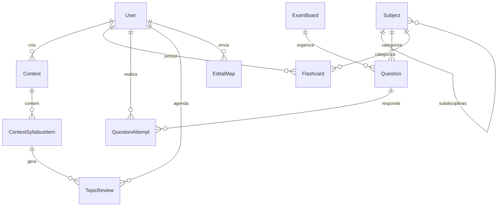

# Auditoria Técnica e Arquitetural — Mapa de Revisão (Engrama)
**Documento:** `docs/mindmap/00-audit.md`  
**Fase:** Fase 0 — Auditoria (Somente Leitura) — GATE  
**Data:** 19/11/2026  
**Status:** Aguardando Aprovação do Engenheiro Responsável ("OK AUDITORIA")

---

## 1. Inventário de Arquivos e Diretórios Analisados

Durante a execução da Fase 0 (leitura e auditoria estrita sem alteração de código operacional), foram inspecionados os seguintes arquivos e diretórios:

1. **Modelagem de Dados e Banco:**
   - `apps/backend/prisma/schema.prisma` (1.086 linhas, 46 modelos Prisma inspecionados).
   - `apps/backend/src/database/prisma.ts` (conexão e instâncias de cliente).
2. **Serviços de Edital, Estudo e Conteúdo no Backend:**
   - `apps/backend/src/services/edital-map.service.ts` (lógica de extração PDF, `calculateCoverage`, `analyzeProbabilities`).
   - `apps/backend/src/controllers/edital-map.controller.ts` (endpoints de mapeamento e análise de edital).
   - `apps/backend/src/routes/edital-map.routes.ts` (rotas `/api/edital-map`).
   - `apps/backend/src/interfaces/ai.interfaces.ts` (`ZionEditalTree`, `ZionEditalSubject`, `ZionProbabilityItem`).
   - `apps/backend/src/services/study.service.ts` e `apps/backend/src/controllers/study.controller.ts`.
   - `apps/backend/src/services/flashcard.service.ts` e `apps/backend/src/controllers/flashcard.controller.ts`.
   - `apps/backend/src/services/anonymization.service.ts` e `apps/backend/src/controllers/auth.controller.ts` (LGPD / DSAR export).
   - `apps/backend/src/config/env.ts` (variáveis de ambiente, autenticação, IA e limites).
3. **Frontend (Rotas, Layout, UI e Dependências):**
   - `apps/frontend/package.json` (dependências e scripts).
   - `apps/frontend/src/routes/index.tsx` (árvore de rotas com React Router v7).
   - `apps/frontend/src/styles/tokens.css` e `apps/frontend/src/styles/globals.css` (tokens de cor, movimento e tema).
   - `apps/frontend/src/lib/motion.ts` e `apps/frontend/src/lib/motion.test.ts` (tokens tipados e WCAG AA).
   - `apps/frontend/src/pages/ContestsPage.tsx`, `StudyPage.tsx`, `FlashcardsPage.tsx`, `ErrorNotebookPage.tsx`.
   - `apps/frontend/src/features/contests/components/` (`ContestDetailView.tsx`, `DisciplineGroup.tsx`, `TopicReviews.tsx`).
   - `docs/ux/motion-guidelines.md` e `docs/ux/ux-principles-map.md`.

---

## 2. Bibliotecas Encontradas e Divergências com o Código Real

### 2.1. Bibliotecas Instaladas Atualmente
- **Frontend (`apps/frontend/package.json`):**
  - React: `^19.1.0` (React 19).
  - Roteamento: `react-router: ^7.6.0`.
  - Estilização: `tailwindcss: ^4.1.0` (Tailwind v4) com `@tailwindcss/vite`.
  - Ícones: `lucide-react: ^0.513.0`.
  - Estado assíncrono: `@tanstack/react-query: ^5.75.0`.
  - Validação: `zod: ^3.25.0`.
  - Utilitários: `clsx: ^2.1.1`, `tailwind-merge: ^3.7.0`, `class-variance-authority: ^0.7.1`.
- **Backend (`apps/backend/package.json`):**
  - Framework: `express: ^5.1.0`.
  - ORM: `@prisma/client: ^6.9.0` (MySQL/MariaDB).
  - Cache/Filas: `ioredis: ^6.0.0` (Redis).
  - IA: `openai: ^7.38.0`, `@anthropic-ai/sdk: ^0.132.1`.
  - Parser PDF: `pdf-parse: ^2.4.5`.
  - Validação: `zod: ^3.25.0`.

### 2.2. Divergências e Peculiaridades Encontradas
1. **Nenhuma biblioteca de visualização de grafos/árvores instalada:** Não constam no projeto `react-force-graph`, `d3-force`, `@xyflow/react` ou `d3-flextree`. Elas precisarão ser adicionadas nas fases competentes (com licenças devidamente checadas e compatibilidade garantida com React 19).
2. **Rota `/mapa` existente apenas como redirect:** Atualmente, a rota `/mapa` no frontend redireciona sumariamente para `/contests` (`<Route path="/mapa" element={<Navigate to="/contests" replace />} />`).
3. **Estrutura de Edital Desnormalizada vs Normalizada:**
   - O modelo `EditalMap` grava a árvore do edital como um único blob JSON (`topicsTree: Json`), sem identificadores relacionais para cada subtópico.
   - O modelo `ContestSyllabusItem` tem registros no banco, porém é plano (apenas campos `discipline` e `topic` em texto), sem hierarquia de nós-pais/nós-filhos e sem relacionamento de grafo.
4. **Desconexão de Conteúdo de Estudo com Itens de Edital:**
   - As questões (`Question`) e flashcards (`Flashcard`) relacionam-se diretamente com o modelo `Subject` (taxonomia macro como "Direito Administrativo") e não com nós/tópicos específicos de um edital ou do concurso.
5. **Agendamento de Revisões já existente:**
   - O modelo `Flashcard` implementa SM-2 puro (`interval`, `easeFactor`, `repetition`, `nextReview`).
   - O modelo `TopicReview` implementa agendamento espaçado por intervalos fixos de dias (ex.: 1, 7, 15, 30 dias) atrelado a `ContestSyllabusItem`.
   - **Compromisso:** Não inventaremos novos agendadores; o mapa consumirá as revisões vencidas dessas tabelas existentes.

---

## 3. Auditoria do Modelo de Dados Atual

### 3.1. Entidades Existentes e Seus Relacionamentos



### 3.2. Análise Detalhada dos Modelos

| Entidade | Campos-Chave | Relaciona-se com Tópico? | Lacuna Identificada |
|---|---|:---:|---|
| **`Subject`** | `id`, `name`, `parentId`, `order` | Macro (taxonomia) | É uma taxonomia geral do sistema (32 registros), não reflete as especificidades de cada edital de concurso. |
| **`Contest`** | `id`, `userId`, `name`, `examBoard`, `role`, `examDate`, `status` | Não | Concurso do usuário. Contém metadados da prova-alvo. |
| **`ContestSyllabusItem`** | `id`, `contestId`, `discipline`, `topic`, `studied`, `importance` | Parcialmente | Estrutura plana em texto. Não possui relações de dependência entre tópicos (arestas) nem subtópicos estruturados. |
| **`EditalMap`** | `id`, `userId`, `editalName`, `banca`, `topicsTree` (JSON) | Em JSON | A árvore é um JSON isolado por upload de usuário. Não forma um grafo compartilhado consultável de forma eficiente. |
| **`Question`** | `id`, `statement`, `subjectId`, `examBoardId`, `difficulty` | ❌ Não aponta para tópico | Aponta apenas para `Subject` macro e `ExamBoard`. Não sabe a qual tópico específico do edital pertence. |
| **`QuestionAttempt`** | `id`, `userId`, `questionId`, `isCorrect`, `timeSpent` | Indireto via Question | Registra respostas do aluno, mas para saber o domínio de um tópico é necessário transitar pela questão. |
| **`Flashcard`** | `id`, `userId`, `subjectId`, `deckId`, `nextReview`, `easeFactor` | ❌ Não aponta para tópico | Aponta para `Subject` e `FlashcardDeck`. O deck possui um campo textual `topic?: string`. |
| **`TopicReview`** | `id`, `userId`, `syllabusItemId`, `scheduledFor`, `completedAt` | Sim (`syllabusItem`) | Gerencia agendamento espaçado do tópico estudado pelo aluno no concurso. |

---

## 4. Incidência por Banca

### 4.1. Situação Atual no Produto
- Existe a entidade `ExamBoard` (8 bancas cadastradas: Cebraspe, FCC, FGV, Vunesp, etc.) vinculada a `Question`.
- O método `EditalMapService.analyzeProbabilities` envia o edital para LLM, retornando `'alta' | 'media' | 'baixa'` com justificativa e persistindo em `probabilityAnalysis: Json`.
- O modelo `ContestSyllabusItem` possui o campo numérico `importance: Int @default(5)` (escala de 1 a 5).

### 4.2. Proposta de Obtenção Sem "Inventar Números"
Para manter o mapa **estatisticamente fundamentado**:
1. **Camada 1 — Estatística Histórica Real (Determinística):** Para tópicos que possuam questões cadastradas na base associadas à respectiva `ExamBoard`:
   $$\text{Frequência} = \frac{\text{Questões da Banca no Tópico}}{\text{Total de Questões da Banca na Disciplina}}$$
2. **Camada 2 — Classificação Qualitativa por Edital (IA com Curadoria Humana):** Quando não houver base estatística suficiente de questões passadas da banca para um tópico inédito, utilizar o peso atribuído pelo edital e a análise de recorrência do edital mapeado (`alta: 1.0`, `media: 0.6`, `baixa: 0.3`), com obrigatoriedade de fonte e aprovação humana registrada no sistema.

---

## 5. Fluxos de Revisão Existentes e Deep Links

O mapa de revisão **não duplicará telas nem lógica de estudo**, atuando como hub de direcionamento através de deep links para as rotas já existentes:

| Fluxo de Revisão | Rota Existente | Mecanismo de Acionamento Atual | Deep Link a ser Usado pelo Mapa |
|---|---|---|---|
| **Revisar Flashcards Vencidos** | `/flashcards` | `StudySession` acionado por deck com cards vencidos (`nextReview <= now`). | `/flashcards?topicId={topicId}&mode=due` |
| **Refazer Questões Erradas** | `/study` ou `/error-notebook` | `StudyPage` recebe `{ questions, mode: 'STUDY' }` via navigation state; `/error-notebook` lista pendências. | `/study?topicId={topicId}&filter=errors` |
| **Treinar Questões do Tópico** | `/study` | `GeneratePage` ou filtros de questões despacham para `/study`. | `/study?topicId={topicId}&mode=STUDY` |
| **Revisão Espaçada do Tópico** | `/contests` | `TopicReviews` marca revisão como concluída via `completeReview(reviewId)`. | Ação direta via API no painel lateral do nó ou redirect para `/contests?item={id}` |
| **Simulados com o Tópico** | `/exam-slicer` / `/generate` | Gera simulado com filtro de disciplina e banca. | `/generate?topicId={topicId}` |

---

## 6. Frontend: Arquitetura, Tema, Motion e Mobile

1. **Roteamento:** React Router v7. O endpoint visual será `/mapa` (substituindo o redirect provisório atual) com persistência de estado em query param (`/mapa?node={topicId}&view=constellation|tree`).
2. **Design System & Temas:**
   - Sistema **Engrama** com paleta semântica primária baseada em **Verde-revisão** (Teal `#2E8C82`) e **Âmbar** (`#F2A93B` para destaques/atenção).
   - Suporte nativo a Light Mode e Dark Mode via classes Tailwind e variáveis CSS (`tokens.css`).
3. **Tokens de Movimento e Acessibilidade:**
   - Durações semânticas padronizadas: `duration-instant` (80ms), `duration-fast` (140ms), `duration-base` (220ms), `duration-slow` (320ms), `duration-deliberate` (450ms).
   - Curvas naturais: `ease-standard`, `ease-exit`, `ease-in-out`, `ease-overshoot`.
   - Suporte inegociável a `@media (prefers-reduced-motion: reduce)` já injetado globalmente em `globals.css` (zerando durações de animações).
4. **Comportamento Mobile:**
   - No mobile, a visão padrão deve ser a **árvore vertical recolhível** (conforme decisão de produto), com grafos locais restritos sob demanda (1 tópico e vizinhos imediatos), respeitando estritamente o orçamento de processamento e alvos de toque da Lei de Fitts (mínimo `44px`).

---

## 7. Levantamento de Volume e Dimensionamento

### 7.1. Dados no Ambiente Local
- Usuários cadastrados: **3**
- Disciplinas (`Subject`): **32**
- Bancas cadastradas: **8**
- Flashcards: **10** (1 deck)
- Questões: **0** (ambiente limpo pré-seeding)
- Concursos / Editais: **0**

### 7.2. Estimativa de Produção e Dimensionamento
- **Número de tópicos por edital típico:** entre **120 e 350 tópicos/subtópicos** por edital estruturado.
- **Número de arestas de relações por edital:** estimativa de **150 a 500 relações** aprovadas (pré-requisito, se confunde com, cai junto).
- **Volume de Usuários Ativos:** `CONFIRMAR COM GABRIEL`.
- **Dimensionamento de Payload:**
  - `GET /api/map/graph` (compartilhado e cacheado via Redis/ETag): ~40 KB a 80 KB JSON bruto (~10 KB a 18 KB com compressão gzip/brotli).
  - `GET /api/map/overlay` (privado por usuário): dicionário indexado de ~150 a 350 entradas: ~8 KB a 18 KB JSON bruto (~3 KB a 5 KB gzip).

---

## 8. Proposta de Modelo de Dados para o Mapa de Revisão

Para atender à regra de **separação estrita entre grafo compartilhado e overlay pessoal**, propõe-se a seguinte estrutura normalizada no Prisma:

```prisma
// ═══════════════════════════════════════════════════════════════════
// GRAFO COMPARTILHADO (Estrutura Canônica do Edital e Relações)
// ═══════════════════════════════════════════════════════════════════

enum TopicLevel {
  DISCIPLINE
  TOPIC
  SUBTOPIC
}

enum RelationType {
  PREREQUISITE   // "Pré-requisito para"
  CONFUSED_WITH  // "Se confunde com"
  CO_OCCURRING   // "Cai junto com"
}

enum RelationStatus {
  DRAFT     // Gerada por IA ou submetida, aguardando curadoria
  APPROVED  // Revisada e aprovada por humano -> vai ao grafo público
  REJECTED  // Rejeitada na curadoria
}

model Topic {
  id          String     @id @default(cuid())
  parentId    String?
  name        String     @db.VarChar(255)
  slug        String     @db.VarChar(255)
  level       TopicLevel @default(TOPIC)
  order       Int        @default(0)
  description String?    @db.Text
  subjectId   String?    // Vínculo opcional com a taxonomia macro Subject existente
  createdAt   DateTime   @default(now())
  updatedAt   DateTime   @updatedAt

  parent         Topic?                @relation("TopicHierarchy", fields: [parentId], references: [id], onDelete: Cascade)
  children       Topic[]               @relation("TopicHierarchy")
  subject        Subject?              @relation(fields: [subjectId], references: [id], onDelete: SetNull)
  
  outgoingRelations TopicRelation[]    @relation("SourceTopic")
  incomingRelations TopicRelation[]    @relation("TargetTopic")
  incidences        TopicIncidence[]
  userMasteries     UserTopicMastery[]
  layoutPositions   TopicLayoutPosition[]
  questions         Question[]          // Permite vincular questões diretamente ao tópico
  flashcards        Flashcard[]         // Permite vincular flashcards diretamente ao tópico

  @@index([parentId])
  @@index([subjectId])
  @@index([level])
}

model TopicRelation {
  id            String         @id @default(cuid())
  sourceTopicId String
  targetTopicId String
  type          RelationType
  evidence      String         @db.Text       // Justificativa e citação da fonte jurídica/doutrinária
  source        String?        @db.VarChar(255) // Ex: "Art. 37 CF/88", "Súmula 123 STJ"
  status        RelationStatus @default(DRAFT) // NUNCA vai ao grafo público enquanto DRAFT
  confidence    Float?         // Confiança atribuída pela IA (0.0 a 1.0)
  createdById   String?        // ID do autor ou "AI_PIPELINE"
  reviewedById  String?        // ID do curador humano responsável pela publicação
  reviewedAt    DateTime?
  rejectionReason String?      @db.Text
  createdAt     DateTime       @default(now())
  updatedAt     DateTime       @updatedAt

  sourceTopic Topic @relation("SourceTopic", fields: [sourceTopicId], references: [id], onDelete: Cascade)
  targetTopic Topic @relation("TargetTopic", fields: [targetTopicId], references: [id], onDelete: Cascade)

  @@unique([sourceTopicId, targetTopicId, type])
  @@index([status])
  @@index([sourceTopicId])
  @@index([targetTopicId])
}

model TopicIncidence {
  id             String   @id @default(cuid())
  topicId        String
  examBoardId    String
  weight         Float    @default(1.0) // Peso estatístico relativo (ex: 0.1 a 1.0)
  questionsCount Int      @default(0)   // Total de questões mapeadas na banca
  createdAt      DateTime @default(now())
  updatedAt      DateTime @updatedAt

  topic     Topic     @relation(fields: [topicId], references: [id], onDelete: Cascade)
  examBoard ExamBoard @relation(fields: [examBoardId], references: [id], onDelete: Cascade)

  @@unique([topicId, examBoardId])
  @@index([topicId])
  @@index([examBoardId])
}

model TopicLayoutPosition {
  id           String   @id @default(cuid())
  graphVersion String   @db.VarChar(64) // Hash SHA-256 do grafo estático
  topicId      String
  x            Float
  y            Float
  pinned       Boolean  @default(true)
  createdAt    DateTime @default(now())

  topic Topic @relation(fields: [topicId], references: [id], onDelete: Cascade)

  @@unique([graphVersion, topicId])
  @@index([graphVersion])
}

// ═══════════════════════════════════════════════════════════════════
// CAMADA PRIVADA DO USUÁRIO (Overlay de Domínio e Revisões)
// ═══════════════════════════════════════════════════════════════════

enum MasteryState {
  NOT_STARTED  // Não estudado (visual tracejado / baixa opacidade)
  IN_PROGRESS  // Em andamento
  MASTERED     // Dominado
}

model UserTopicMastery {
  id                 String       @id @default(cuid())
  userId             String
  topicId            String
  masteryScore       Float        @default(0.0) // 0.0 a 100.0 (determina a cor em matiz única)
  state              MasteryState @default(NOT_STARTED)
  attemptsCount      Int          @default(0)   // Questões respondidas
  correctCount       Int          @default(0)   // Questões acertadas
  accuracy           Float        @default(0.0) // Taxa bruta de acertos (0.0 a 1.0)
  lastAttemptAt      DateTime?
  dueFlashcardsCount Int          @default(0)   // Flashcards vencidos hoje (anel/badge)
  priorityScore      Float        @default(0.0) // Incidência × Lacuna
  calculatedAt       DateTime     @default(now())
  updatedAt          DateTime     @updatedAt

  user  User  @relation(fields: [userId], references: [id], onDelete: Cascade)
  topic Topic @relation(fields: [topicId], references: [id], onDelete: Cascade)

  @@unique([userId, topicId])
  @@index([userId])
  @@index([topicId])
  @@index([userId, priorityScore])
}
```

---

## 9. Proposta da Fórmula de Domínio (Mastery Score)

### 9.1. Princípios da Fórmula
1. **Ponderação por Recência com Decaimento Temporal (Ebbinghaus):** Um acerto ocorrido hoje possui maior peso na retenção do que um acerto de 60 dias atrás.
2. **Amostra Mínima:** Sem um volume mínimo de tentativas, o tópico não salta prematuramente para "Dominado".
3. **Ponderação Multi-instrumento:** Questões em simulados completos carregam peso avaliativo maior que flashcards de reconhecimento passivo.

### 9.2. Formulação Proposta com Parâmetros `A DEFINIR`

Para cada tentativa $i$ realizada pelo usuário no tópico, define-se o peso temporal com meia-vida $\lambda$:
$$w_i = e^{-\frac{\Delta t_i}{\text{HALF\_LIFE\_DAYS}}}$$

Onde $\Delta t_i$ é o número de dias decorridos desde a resolução da questão.

A acurácia temporalmente ponderada ($A_w$) é calculada por:
$$A_w = \frac{\sum_{i=1}^{N} w_i \cdot \text{isCorrect}_i}{\sum_{i=1}^{N} w_i}$$

O **Score de Domínio Base ($D_{\text{base}}$)** combina a acurácia ponderada com um amortecedor bayesiano para pequenas amostras:
$$D_{\text{base}} = \left( \frac{N}{N + \text{MIN\_SAMPLE\_BUFFER}} \cdot A_w + \frac{\text{MIN\_SAMPLE\_BUFFER}}{N + \text{MIN\_SAMPLE\_BUFFER}} \cdot \text{PRIOR\_ACCURACY} \right) \times 100$$

Ajuste por Flashcards Vencidos e Retenção SM-2:
$$D_{\text{final}} = \max\left(0, D_{\text{base}} - (\text{dueFlashcards} \times \text{PENALTY\_PER\_DUE\_CARD})\right)$$

**Classificação dos Estados de Domínio:**
- `NOT_STARTED`: se $N < \text{MIN_ATTEMPTS_THRESHOLD}$
- `IN_PROGRESS`: se $N \ge \text{MIN_ATTEMPTS_THRESHOLD}$ e $D_{\text{final}} < \text{MASTERY_THRESHOLD}$
- `MASTERED`: se $N \ge \text{MIN_ATTEMPTS_THRESHOLD}$ e $D_{\text{final}} \ge \text{MASTERY_THRESHOLD}$

**Prioridade de Revisão (Acionabilidade):**
$$\text{Lacuna} = 100 - D_{\text{final}}$$
$$\text{Prioridade} = \text{Incidência} \times \text{Lacuna}$$

| Parâmetro | Significado | Valor Sugerido | Status |
|---|---|:---:|:---:|
| `MIN_ATTEMPTS_THRESHOLD` | Amostra mínima de questões para sair de "Não Estudado" | `3` | `A DEFINIR` |
| `MIN_SAMPLE_BUFFER` | Constante de suavização Bayesiana para amostras pequenas | `5` | `A DEFINIR` |
| `PRIOR_ACCURACY` | Acurácia a priori esperada (baseline neutro) | `0.50` (50%) | `A DEFINIR` |
| `HALF_LIFE_DAYS` | Meia-vida em dias para decaimento temporal de acertos | `21` dias | `A DEFINIR` |
| `MASTERY_THRESHOLD` | Nota de corte percentual para o estado "Dominado" | `75.0` | `A DEFINIR` |
| `PENALTY_PER_DUE_CARD` | Penalidade no score por cada card vencido acumulado | `3.0` pts | `A DEFINIR` |
| `W_QUESTIONS` | Peso relativo de resolução de questões convencionais | `1.0` | `A DEFINIR` |
| `W_EXAMS` | Peso relativo de questões respondidas em modo simulado | `1.4` | `A DEFINIR` |
| `W_FLASHCARDS` | Peso relativo de cards dominados via SM-2 | `0.6` | `A DEFINIR` |

---

## 10. Perguntas Abertas para o Gabriel

1. **Origem Canônica dos Tópicos:** Os tópicos do grafo público compartilhado serão originados a partir da extração dos editais já existentes no banco (`EditalMap` / `ContestSyllabusItem`), de uma base centralizada de editais previamente cadastrada pela equipe Engrama, ou da expansão hierárquica do modelo `Subject`?
2. **Bancas e Concursos Piloto:** Quais bancas examinadoras e concursos específicos devemos adotar como massa de teste para a Fase 1 (ex.: Cebraspe / Polícia Federal, FGV / OAB ou Receita Federal)?
3. **Mapeamento de Questões Legadas:** Como as questões atuais não possuem `topicId` (possuem apenas `subjectId`), deseja que criemos um script de categorização assistida por IA (ou heurística por palavras-chave) para associar as questões existentes aos novos tópicos canônicos?
4. **Volume Estimado de Usuários e Nós:** Qual o volume estimado de usuários ativos simultâneos esperados na funcionalidade para balizarmos os caches de Redis e orçamentos de memória?
5. **Critério de Curadoria de Relações:** Quem será o revisor humano inicial das relações (`PREREQUISITE`, `CONFUSED_WITH`, `CO_OCCURRING`) geradas pela IA? Implementaremos uma tela simples administrativa interna no `/admin` para aprovação/rejeição em lote?
